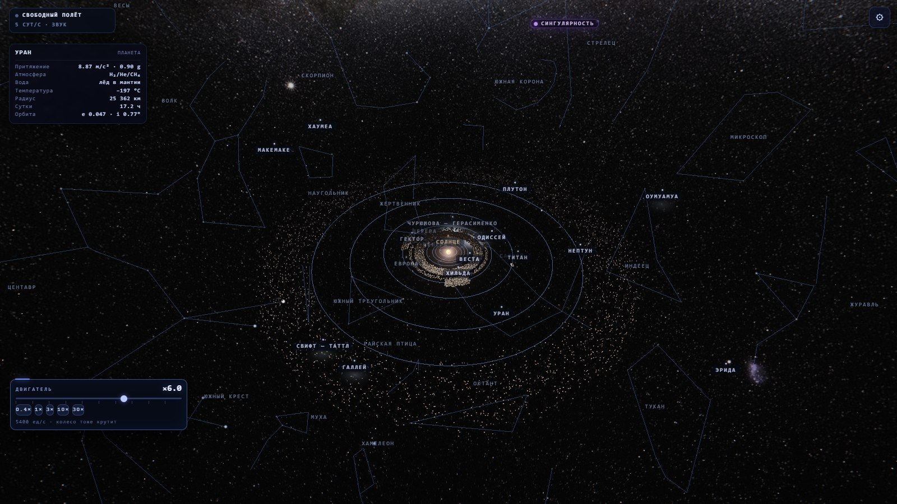

# Solar System

**Демо:** <https://indapublic.github.io/solar-system-webgpu/> ·
**Обои:** <https://indapublic.github.io/solar-system-webgpu/wall.html?wall>



Интерактивная Солнечная система в браузере на чистом **WebGPU**: без движков, библиотек и
фреймворков. Солнце, восемь планет с настоящими картами, восемь лун, два аппарата, кольца,
пояс астероидов, кометы, карликовые планеты, межзвёздные объекты, реальное звёздное небо с
созвездиями и подписями, чёрная дыра как пасхалка — и свободный полёт через всё это.

Всё движется по дате: планеты идут по настоящим кеплеровским орбитам с эксцентриситетом и
наклоном, малые тела — по своим элементам JPL, Луна показывает настоящую фазу. Время можно
ускорить до 2000 суток в секунду, остановить или пустить назад; есть календарь, поиск по всем
объектам, плавные перелёты, безопасный режим, закладки видов и настройки режима обоев.

> An interactive Solar System on raw WebGPU — real Keplerian orbits and ephemerides, planet
> maps, constellation names, eclipses and free flight. No engines, no dependencies.

---

## Содержание

- [Быстрый старт](#быстрый-старт)
- [Файлы проекта](#файлы-проекта)
- [Управление](#управление)
- [Что есть в сцене](#что-есть-в-сцене)
- [Архитектура и кадр](#архитектура-и-кадр)
- [Симуляция: время, орбиты, точность](#симуляция-время-орбиты-точность)
- [Масштаб сцены](#масштаб-сцены)
- [Планеты, луны, малые тела](#планеты-луны-малые-тела)
- [Реальное звёздное небо и созвездия](#реальное-звёздное-небо-и-созвездия)
- [Материалы, атмосферы, рельеф, кольца](#материалы-атмосферы-рельеф-кольца)
- [Тени и затмения](#тени-и-затмения)
- [Кометы и хвосты](#кометы-и-хвосты)
- [Солнце: жар и гибель](#солнце-жар-и-гибель)
- [Атмосферный вход и столкновения](#атмосферный-вход-и-столкновения)
- [Чёрная дыра](#чёрная-дыра)
- [Камера и слежение](#камера-и-слежение)
- [Поиск и плавные перелёты](#поиск-и-плавные-перелёты)
- [Безопасное исследование](#безопасное-исследование)
- [Закладки и ссылки](#закладки-и-ссылки)
- [Интерфейс и подписи](#интерфейс-и-подписи)
- [Настройки и сохранение](#настройки-и-сохранение)
- [Качество и производительность](#качество-и-производительность)
- [Звук](#звук)
- [Режим обоев и сборка в один файл](#режим-обоев-и-сборка-в-один-файл)
- [Инструменты разработки](#инструменты-разработки)
- [Отладка](#отладка)
- [Как это устроено технически](#как-это-устроено-технически)
- [Где что менять](#где-что-менять)
- [Ограничения и честные оговорки](#ограничения-и-честные-оговорки)
- [Что дальше](#что-дальше)
- [Лицензия](#лицензия)
- [Ассеты, данные и лицензии](#ассеты-данные-и-лицензии)

---

## Быстрый старт

Нужен Chrome или Edge с включённым WebGPU (в современных сборках включён по умолчанию).

```bash
node server.mjs
```

Открыть <http://localhost:8099/>. Сервер обязателен для обычной версии: текстуры грузятся
`fetch`-ем из `assets/`, по `file://` браузер их не отдаст. Порт можно задать:
`node server.mjs 8080`.

Сборка для обоев (одна HTML со вшитыми текстурами) открывается без сервера:

```bash
node tools/inline.mjs            # → wall.html, ~12.0 МБ
# открыть wall.html?wall
```

Параметр `?wall` включает режим обоев. Без него `wall.html` — просто автономная копия
интерактивной версии.

---

## Файлы проекта

| Файл | Что |
| --- | --- |
| `index.html` | всё приложение: разметка, CSS, JS, WGSL-шейдеры, данные звёзд и орбит (~368 КБ, ~6100 строк) |
| `wall.html` | standalone-сборка: те же исходники + 15 текстур в `data:`URL (~12.0 МБ) |
| `LICENSE` | MIT для кода |
| `ATTRIBUTION.md` | лицензии и атрибуция текстур, каталога звёзд и данных JPL |
| `docs/` | скриншот для README и картинка Open Graph |
| `server.mjs` | минимальный статический сервер на 8099 |
| `assets/` | 15 файлов: карты планет, панорама Млечного Пути, профиль колец |
| `tools/stars.mjs` | тянет каталог d3-celestial и вшивает звёзды, линии и имена созвездий |
| `tools/inline.mjs` | собирает `wall.html`, вшивая все ассеты в base64 |
| `tools/shot.mjs` | скриншоты через CDP в настоящем Chrome (с навигацией, клавишами, JS) |
| `tools/expand.mjs`, `tools/dump.mjs` | печать WGSL-констант после подстановки `${...}` и по имени |

Ассеты не дублируются в HTML обычной версии — только в `wall.html`.

---

## Управление

| Клавиши / действие | Что делают |
| --- | --- |
| `W` `A` `S` `D` | полёт вперёд/влево/назад/вправо |
| `Q` `E` | вниз / вверх |
| `Shift` | ускорение ×6 |
| Мышь | обзор; клик по кадру — захват указателя, `Esc` — отпустить |
| Колесо | множитель скорости полёта 0.15×…40× |
| `1`–`8` | плавный перелёт к Меркурию … Нептуну, по прибытии — слежение |
| `9` | к Солнцу |
| `0` | к Луне |
| `T` | слежение за ближайшим телом / отпустить |
| клик по подписи | взять конкретное тело в слежение |
| `F` или `/` | поиск объекта (стрелки, `Enter`, `Esc`) |
| `Esc` | закрыть окно/поиск, пропустить перелёт; иначе закрыть настройки, вернуть интерфейс и отпустить мышь |
| `B` | к чёрной дыре |
| `V` | обзор системы сверху (камера 0, 36000, 43000) |
| `O` | панель настроек |
| `+` `−` | скорость времени, шаг ×1.35 |
| `M` | звук вкл/выкл |
| `L` | язык RU / EN |
| `H` | телеметрия (`?hud` включает сразу) |
| `G` | показать/скрыть блок «Двигатель» |
| `R` | прервать вход в атмосферу / выбраться из Солнца и чёрной дыры |
| `Tab` | спрятать/показать весь интерфейс |
| `⚙` справа сверху | панель настроек |
| `⌕` справа сверху | поиск объекта |

Клик по пустому кадру захватывает мышь. В режиме обоев ввод отключён, курсор скрыт.

---

## Что есть в сцене

- **8 планет** с картами Solar System Scope: Меркурий, Венера (облачный слой), Земля (день,
  ночь, clouds), Марс, Юпитер, Сатурн, Уран, Нептун.
- **8 лун**: Луна (с картой), Фобос, Деймос, Ио, Европа, Ганимед, Каллисто, Титан
  (остальные — цветом из юниформа).
- **20 малых тел**: 4 кометы, 8 карликовых планет/астероидов, 3 из семейства Хильды,
  3 объекта пояса Койпера, 2 межзвёздных.
- **Хаббл и МКС** — низкополигональные сетки, а не сферы.
- **Пояса**: 4200 камней главного пояса, 1400 троянцев Юпитера, 600 Хильды, 2600 Койпера.
- **Реальное небо**: 288 звёзд до 3.5ᵐ, 743 отрезка линий 89 созвездий, 89 названий на двух
  языках.
- **Кольца** Сатурна (профиль с альфой) и Урана (две узкие тёмные полосы).
- **Чёрная дыра** за Койпером, в 95 000 единиц от Солнца.
- **Тени**: затмения лун и транзиты по дискам; тень колец на Сатурне.
- **Атмосферное гало** у Земли, Венеры, Титана, Марса и газовых гигантов.
- **Псевдорельеф** у каменистых тел по градиенту альбедо.
- **Огни городов** на ночной стороне Земли и отдельный слой облаков.
- **Эффекты**: жар Солнца, вход в атмосферу, разрушение астероидов, падение в чёрную дыру.

Итого в `ALL` — 39 тел: 8 планет + 8 лун + 20 малых + 2 аппарата + Солнце. В юниформе
зарезервировано 40 слотов (`NB_MAX = 40`).

---

## Архитектура и кадр

Всё живёт в одном файле и одном `<script>`. Порядок кадра:

1. **CPU-модель.** `updateBodies(dt)` двигает время (`simDays`) и считает положения:
   планеты — по элементам Кеплера, луны — по круговым орбитам вокруг родителей, малые тела —
   по своим элементам, аппараты — по низким орбитам у Земли. Результат раскладывается в
   юниформ тел: 40 × 24 float (позиция, радиус, ось, слой текстуры, кольца, тип, материал).
2. **Сцена** — один фуллскрин-шейдер (`SCENE`) в `rgba16float`. На каждый пиксель: луч,
   панорама неба, опционально гравитация чёрной дыры, объёмное звёздное поле, пересечение с
   40 сферами, кольцами и хвостами комет, освещение, тени, атмосферы, рельеф, облака и огни
   Земли. Пишет линейную глубину `t / 400000` в `depth32float`.
3. **Орбиты планет** — отдельный line-list (`pOrb`) по настоящим эллипсам, глубина как у
   сцены, аддитивное смешивание, затухание вблизи плоскости и камеры.
4. **Звёзды и созвездия** — отдельный аддитивный проход (`pStar`, `pLine`) на бесконечности
   (`depth = 1.0`): их закрывают тела, но не наоборот.
5. **Хаббл и МКС** — сетки (`pHst`) с проверкой глубины, вершины трансформируются на CPU.
6. **Пояса** — инстансированные SDF-импосторы (`pBelt`): 4200 + 1400 + 600 + 2600 квадов,
   общий шейдер, процедурные формы/материалы, LOD и запись глубины поверхности.
7. **Чёрная дыра** — отдельный проход (`pBH`) поверх слоёв: premultiplied alpha,
   проверка глубины без записи, тень и полупрозрачный диск; линзированный фон подставляется
   только на глубину неба.
8. **Орбиты у дыры** — при подлёте рисуются после `pBH`, чтобы каждая точка линии сама
   учитывала тень и диск; без видимой дыры остаются на шаге 3.
9. **Bloom** — 5 уровней down/up в HDR, уже после перекрытия дырой.
10. **Композит** — ACES, гамма 2.2, хроматическая аберрация, зерно, виньетка, тепловой мираж.
11. **HTML-слои** — подписи тел, имена созвездий, метка чёрной дыры, статус, карточка физики.

Сцена не использует вершинные меши для планет: сферы, кольца и хвосты считаются аналитически
в фрагментном шейдере. Поэтому нет полигонов, LOD и z-fighting, а лимб гладкий на любом
расстоянии.

### Юниформы

| Буфер | Размер | Содержимое |
| --- | --- | --- |
| `ubo` | 128 Б | камера, right/up/fwd, разрешение, bloom/зерно/виньетка/флаги, Солнце |
| `bodyBuf` | 40 × 96 Б | по 24 float на тело: pos.xyz + радиус, axis.xyz + слой, кольца, тип/кромка/поворот, tint, материал |
| `cometBuf` | 8 × 64 Б | голова, ионный и пылевой хвосты, запас |

Флаги в `misc.w`: бит 0 — орбиты (исторический, теперь линии отдельно), бит 1 — огни
городов, бит 2 — кольца, бит 3 — глубокое поле, бит 4 — чёрная дыра.

### Шейдеры

| Константа | Что считает |
| --- | --- |
| `SCENE` | весь рейтрейсинг сцены (небо, тела, кольца, тени, атмосферы, хвосты) |
| `SKY_SHADER` | звёзды (инстансированные квады) и линии созвездий |
| `BELT` | камни поясов: SDF-импостор, семейства формы, материалы, LOD, frag-depth |
| `HST_SHADER` | сетки «Хаббла» и МКС |
| `ORB_SHADER` | линии орбит планет |
| `FINAL` | композит: ACES, тепловой мираж, аберрация, зерно, виньетка |
| `NOISE` | хеш-функции, подставляются в остальные шейдеры |
| `pMip` (инлайн-WGSL) | генерация мипов для массива текстур |

---

## Симуляция: время, орбиты, точность

### Время

- `J2000_MS = Date.UTC(2000, 0, 1, 12:00)`; `simDays = (Date.now() − J2000_MS) / 86400000` —
  при запуске мир стоит в **сегодняшней дате**, с дробной частью суток.
- `DAYS_PER_SEC = 5` — обычный ход. Слайдер времени логарифмический: пауза или
  0.5…2000 суток в секунду. `timeSpeed = timeDir · daysPerSec / 5`.
- Направление времени задаётся отдельно: `◀` / `▶` и `⏸` в панели; скорость можно менять,
  не сбрасывая направление. При движении назад `simDays` уменьшается, тела, вращение,
  малые тела, хвосты и дата считаются тем же кодом.
- Хронометр пересчитывает дату из `J2000_MS + simDays` (UTC) и обновляется дважды в сутки,
  чтобы не трогать DOM каждый кадр.
- Календарь — поле `Дата` (UTC) и кнопка `Сегодня`. Диапазон **1800-01-01 … 2200-12-31**:
  внутри него приближённые элементы планет и JPL-элементы малых тел остаются осмысленными,
  но это не обещание точных эфемерид. Модель двухтельная, без возмущений; для 1800–2050
  ошибка обычно в несколько угловых минут, к краям диапазона растёт.
- Прыжок по дате не считается столкновением: на 500 мс отключается проверка входа и удара,
  а камера, если она не следит за телом, выталкивается из случайно накрывшего её тела.

### Планеты

Для каждой планеты заданы элементы JPL (Standish) на J2000 с вековыми производными:
`a`, `e`, `i`, `Ω`, `ϖ`, `L`, а также `da`, `de`, `di`, `dΩ`, `dϖ`, `dL` за век.

Каждый кадр `planetWorld(el, days)`:

1. `T = days / 36525`, элементы пересчитываются на текущую эпоху;
2. `M = L − ϖ`, уравнение Кеплера `E − e·sin E = M` решается Ньютоном (6 итераций);
3. из `E` берётся точка на эллипсе `x = a(cos E − e)`, `y = a√(1−e²) sin E`;
4. `orbitFrame` поворачивает её на `ω = ϖ − Ω`, `i`, `Ω` в эклиптику;
5. расстояние сжимается тем же множителем, что и у малых тел:
   `s = orbitR(r) / r`;
6. эклиптические `(X, Y, Z)` переводятся в мировые `(X, Z, Y)`: север эклиптики — `+Y`.

`orbitFrame` — общая функция для планет, комет и астероидов. Благодаря этому планета всегда
лежит на своей нарисованной орбите.

### Точность

Сверено с JPL Horizons на 16 ноября 2026, 12:00 UTC (гелиоцентрические эклиптические J2000):

| Тело | Долгота в сцене | Долгота JPL | r в сцене | r JPL, а.е. |
| --- | --- | --- | --- | --- |
| Меркурий | 115.384° | 115.389° | 0.31905 | 0.31906 |
| Земля | 53.765° | 53.769° | 0.98895 | 0.98897 |
| Марс | 107.731° | 107.734° | 1.61022 | 1.61030 |

Расхождение ≤ 0.006° и ≤ 0.0001 а.е. — это уровень самих приближённых элементов, а не
кругового приближения.

### Орбиты как графика

- Полилиния на планету: `ORB_SEG = 192` сегментов, точки считаются той же `orbitFrame` по
  элементам J2000. Планета не уезжает с линии: элементы дрейфуют на сотые доли градуса за
  век.
- Буфер: 8 планет × 192 × 2 вершины, по 24 байта (позиция + цвет), ~72 КБ.
- Шейдер `ORB_SHADER` проецирует мировые точки как меши, пишет глубину как сцена, но не
  перезаписывает её. Затухание: `smoothstep(350, 3200)` по расстоянию до камеры и
  `smoothstep(250, 2600)` по `|cam.y|` — при подлёте к планете линии уходят, чтобы не резать
  кадр.
- Тумблер «Орбиты» отключает только эти линии.

### Луна

Луна пока не по элементам: средняя геоцентрическая долгота на J2000 (218.316°) плюс
сидерический месяц 27.321661 сут. Орбита круговая, наклон 6.7°. Этого достаточно для
правдоподобной фазы, но не для точных затмений.

Фаза в карточке считается по реальному углу Солнце–Земля–Луна:
`(1 − cos φ) / 2`, где `φ` — угол между направлениями на Луну и на Солнце из Земли.

### Малые тела

- Кометы и астероиды: элементы JPL Small-Body Database, эпоха у каждого своя.
- `kepler(el, days)` решает `M = ma + 2π(days − epoch) / P` и то же уравнение Кеплера.
- Гиперболические межзвёздные объекты (`e > 1`) решают `e·sinh H − H = M` (метод Ньютона).
- Все расстояния сжимаются `orbitR(r)` — так малые тела и планеты живут в одном масштабе.

### Аппараты

«Хаббл» и МКС висят у Земли на `orbitR` 36.88 и 36.24 единицы. В масштабе Земли
(1 единица ≈ 187 км) это ≈ 536 и 420 км высоты — близко к настоящим 525–540 и 400–420 км.
Модели увеличены (13 м и 109 м были бы меньше пикселя), высота — нет.

---

## Масштаб сцены

Настоящие расстояния и размеры в одной сцене несовместимы: орбита Нептуна в 30 а.е. при
радиусе Земли 6371 км — это 1:4·10⁹ по радиусу и 1:10¹² по объёму. Поэтому:

- расстояния: `orbitR = 2200 · AU^0.62`;
- радиусы: `radiusOf = 34 · R⊕^0.55`;
- Солнце: `SUN_R = 300` (отдельно, чтобы диск читался);
- периоды обращения и вращения — настоящие, сжимается только время;
- наклоны осей, порядок планет, карты, кольца, эксцентриситеты — настоящие.

Следствия: Земля — 34 единицы, орбита Луны — 210, Сатурн — ~8 900, Нептун — ~18 000.
Сжатие `r^0.62` сохраняет форму орбит, но уменьшает видимый эксцентриситет: Меркурий с
`e = 0.206` выглядит «круглее», чем в реальности. Это компромисс ради облёта системы за
минуты, а не за годы.

---

## Планеты, луны, малые тела

### Данные планет

`PLANETS` задаёт имя, `au`, радиус в радиусах Земли, наклон оси, слой текстуры, период
вращения (`spinH`). `BODIES` добавляет радиус, ось и кольца:

```js
rings: Сатурн ? [1, 1.05, 2.45, 1]   // включены, внутр., внешн. в радиусах, стиль 1
              : Уран ? [1, 1.62, 2.02, 2] : [0, 0, 0, 0]  // стиль 2 — узкие кольца
```

Ось наклона: `[sin(tilt), cos(tilt), 0]` — наклоняется в плоскости X–Y.

### Луны

`MOONS`: Луна, Фобос, Деймос, Ио, Европа, Ганимед, Каллисто, Титан. Радиусы, орбитальные
радиусы (сжатые), настоящие периоды, небольшой наклон. Текстура — только у Луны; остальные
рисуются цветом из `tint` (`flat = 1`), без рельефа.

### Малые тела (20)

- **кометы**: 1P/Галлея, 2P/Энке, 67P/Чурюмова — Герасименко, 109P/Свифта — Таттла;
- **карликовые планеты**: Плутон, Церера, Хаумеа, Макемаке, Эрида;
- **астероиды**: Веста, Паллада;
- **троянцы**: Ахиллес, Гектор, Патрокл, Одиссей;
- **Хильда**: Хильда, Исмена, Чикаго;
- **межзвёздные**: 1I/Оумуамуа, 2I/Борисов.

`SMALL_FROM = 14`, `SMALL_TO = 34` — диапазон в `ALL`.

### Пояса

| Пояс | Камней | Как считается |
| --- | --- | --- |
| главный | 4200 | угол в вершинном шейдере: `ω ∝ r^-1.5`, эпоха `simDays` |
| троянцы | 1400 | CPU каждый кадр вокруг L4/L5 Юпитера |
| Хильда | 600 | вершинный шейдер, резонанс 3:2 |
| Койпер | 2600 | статичное облако 30–50 а.е. с наклонениями |

Камни — **инстансированные SDF-импосторы**, а не плоские круглые спрайты: один draw call на
группу, 24 float на объект (позиция, размер, семейство, seed, масштабы, оси/скорости
вращения, фазы, контактная пара). Процедурная форма строится из низкополигональной базы
(угловатая глыба, вытянутое, сплюснутое, контактная двойная, округлая) с крупными сколами,
впадинами, отдельными кратерами и мелким реголитом. Всё закреплено в объектных координатах
и вращается вместе с камнем.

- **Материалы:** большинство — тёмный углерод/серый/приглушённый бурый; реже светлый камень
  и металл. Различаются не только цветом, но и шероховатостью/слабым бликом.
- **Вращение:** ось, скорость, начальная фаза и медленное кувыркание задаются seed; угол
  считается от `simDays`, поэтому пауза, обратный ход и выбор даты работают корректно.
- **Рельеф:** крупную форму задают цельная база, направленная асимметрия, неоднородная
  деформация объёма и ломаные гребни. Крупная асимметрия сохраняется при LOD; средние гребни плавно уходят ниже пикселя. Угловатое семейство использует перекошенный смешанный L1/L2-объём вместо прямоугольной базы.
  Общей обрезки шестью плоскостями больше нет: сколы ограничены отдельными угловыми
  пятнами разного размера (до трёх у угловатой глыбы, одно меньшее у остальных одиночных тел). У угловатых тел конечные клинья с многоугольными краями дают пересекающиеся поверхности излома; один крупный скол соседствует с меньшими. Ударные кратеры у угловатых и вытянутых тел редки. Радиусы привязки сколов угловатого семейства соответствуют клиновидной базе.
  У вытянутых и кратерированных семейств основной силуэт неровный, без общей огранки;
  средние кратеры имеют чашу, ограниченное дно и неровный приподнятый край. Seed выбирает
  несколько крупных кратеров, более частые мелкие либо преимущественно сколотую поверхность.
  Внутренний объём защищён от вычитания насквозь; контактная пара имеет сплошную перемычку.
  Мелкий реголит и редкие трещины работают в нормалях; их частоты фильтруются по размеру пикселя.
- **Пересечение:** луч восстанавливается из координат пикселя, а не из интерполированных
  нормализованных лучей углов. Квад покрывает касательные к ограничивающей сфере даже
  вблизи near-plane; локальный AABB сужает интервал. Шаг ограничен с учётом деформаций,
  смена знака уточняется бисекцией. После лимита 128 шагов редкие скользящие лучи проходят
  дополнительный поиск пересечения в оставшемся интервале, а не безусловный discard.
  Настоящие промахи не закрашиваются. Подтверждённое пересечение пишет непрозрачный цвет
  и расстояние до поверхности в depth32float; параметры seed/формы передаются без интерполяции.
- **LOD:** детализация выбирается по экранному радиусу; средние кратеры плавно уходят
  ниже пикселя в диапазоне 2–12 px. Крупная асимметрия, seed и база сохраняются; средние повреждения плавно ослабляются ниже пикселя. Далёкий камень
  растягивается до минимального углового размера, чтобы пояс не исчезал.
- **Качество:** эконом/авто снижает разрешение и силу мелких нормалей (бит `512`),
  но не урезает бюджет пересечения и не меняет геометрию крупного близкого камня.
- **Столкновения:** сегмент пути камеры проверяется против эллипсоида/выпуклого обломка формы
  (для контактной пары — две доли и перемычка), а не против маленькой сферы. Быстрый отсев
  угловатой глыбы учитывает диагональ. После slab-отсева AABB минимум выпуклого смешанного L1/L2-поля ищется по всему сегменту с учётом seed, вращения и масштаба. Запас 0.045 соответствует верхней границе выступа рельефа; пустые углы прежней коробки проходимы. Это консервативная оболочка базы, а не точный CPU-порт впадин.

Серии кадров, движение камеры и GPU-аудит формы велись локально и в репозиторий не входят:
это сотни мегабайт изображений. Сводные замеры — в разделе
[качества и производительности](#качество-и-производительность); форма целиком задаётся
seed и параметрами выше.
Воспроизведение текущей формы: `node tools/rock-visual.mjs index.html docs/rock-out`.
В игре нажать ⏸, затем в консоли: `__rockGo(0, 1, -3)` — вытянутый камень в трёх базовых
радиусах; семейства `0` и `4` дают угловатый и округлый камень. Отрицательный третий параметр
означает множитель размера. Помощник не сохраняет настройки и не включает безопасный режим.

---

## Реальное звёздное небо и созвездия

Каталог d3-celestial (Hipparcos/Yale BSC), данные вшиты в `index.html` скриптом
`tools/stars.mjs`:

- **288 звёзд** до 3.5ᵐ с RA/Dec, B−V и блеском;
- **743 отрезка** линий 89 созвездий;
- **89 названий** с полями `ru` и `en`.

RA/Dec → декартова единичная ось → поворот на наклон эклиптики 23.4393° → мировые оси
`(X, Z, Y)`. Небо согласовано с орбитами: Солнце стоит в том зодиакальном созвездии, в
котором должно быть по дате.

### Звёзды и линии

- Звёзды — инстансированные квады (32 байта на звезду), аддитивное смешивание, глубина
  `1.0`, поэтому их закрывают тела.
- Размер и цвет зависят от величины и B−V: голубые O/B, белые A, жёлтые G, оранжевые K,
  красные M.
- Линии созвездий — line-list, цвет `(0.32, 0.48, 0.95) × 0.085`, тоже на бесконечности.
- Тумблеры: «Реальное небо» (звёзды) и «Созвездия» (линии).

### Названия созвездий

HTML-слой `#skyLabels`, а не GPU-проход:

- 89 имён; точка — из `constellations.json`, координаты уже в мировых осях;
- моноширинный капс с разрядкой, `font-size: 9.5px`, `letter-spacing: .22em`,
  прозрачность 0.7;
- де-клаттеринг в экранных пикселях: имя скрывается, если попадает в 105×22 уже
  поставленного имени или 90×18 подписи тела;
- порядок — порядок каталога, поэтому при повороте набор видимых имён меняется плавно;
- скрыто в режиме обоев и в «чистом» виде (`Tab`), переключается тумблером и запоминается.

### Инструмент `tools/stars.mjs`

```bash
node tools/stars.mjs
```

Скачивает `stars.6.json`, `constellations.lines.json`, `constellations.json` из
d3-celestial, фильтрует звёзды `mag ≤ 3.5`, переводит RA/Dec в мировые оси, собирает
строки и заменяет блок между `// __STARS_BEGIN` и `// __STARS_END` в `index.html`.
`CONSTNAME_RAW` пишется через `JSON.stringify`, чтобы апостроф в названии не ломал литерал.
Печатает количество звёзд, отрезков и объём вставки.

---

## Материалы, атмосферы, рельеф, кольца

### PBR

Планеты считаются по GGX: ламбертовский диффуз + блик с распределением GGX, геометрией
Смита—Шлика и членом Френеля; энергия сохраняется (`kD = 1 − F`). Параметры каждого тела —
`(шероховатость, F0, сила блика, маска воды)` — лежат в `bodyData[o+20..23]`.

- **Земля**: блик только по воде; маска считается из дневной карты (`B − R`), поэтому
  солнечный зайчик скользит по океану и не появляется на суше.
- **Газовые гиганты**: почти матовые (`rough 0.92`), блик слабый.
- **Каменистые**: `rough 0.86`, `F0 0.035`, слабый блик.

### Атмосферное гало

За лимбом добавляется тонкое свечение по коду `extra.w`:

| Код | Тело | Цвет | Сила |
| --- | --- | --- | --- |
| 1 | Земля | голубой | 0.85 |
| 2 | Венера | жёлтый | 0.80 |
| 3 | Титан | оранжевый | 0.60 |
| 4 | Марс | розовато-коричневый | 0.35 |
| 5 | газовые гиганты | голубовато-белый | 0.30 |

Ширина привязана к радиусу (`exp(−dh / (0.035R + 0.5))`), яркость умножается на
освещённость точки лимба: на ночной стороне гало не светится. Если перед атмосферой стоит
другое тело, вклад отбрасывается по глубине.

### Псевдорельеф

У каменистых тел (`kind < 0.5`, `rough < 0.9`) нормаль отклоняется по градиенту альбедо:

- 4 дополнительных тапа текстуры (`du = 0.0008`, `dv = 0.0012`);
- тангенциальный базис: east = `normalize(cross(n, axis))`, north = `cross(axis, east)`;
- сила `2.0` и множитель `(0.15 + 0.85·|dot(n, view)|)`, чтобы край диска не рябил.

Это псевдорельеф от яркости, а не карта высот. Кратеры и марии Луны, Меркурия и Марса
читаются объёмно даже на 2K-карте.

### Земля

- дневная карта (слой 2);
- ночные огни (слой 10) — только при включённом тумблере, с маской по яркости;
- облака (слой 11) — отдельный сэмпл с UV-сдвигом `spin·1.07 + 0.9`, смешиваются по
  яркости, на ночной стороне почти не видны.

### Кольца

- **Сатурн**: радиальный профиль из `saturn_rings.png` (2048×125), три тапа по радиусу
  для сглаживания на скользящих углах, вперёд-рассеяние `pow(dot(rd, L), 3)`.
- **Уран**: две узкие тёмные полосы на 1.62 и 2.02 радиуса.
- Тень планеты на кольцах и тень колец на диске планеты считаются аналитически; тень
  колец гасит диск до 75 % по альфе профиля.
- Плотные участки почти непрозрачны (`alpha × 1.2`), цвет подсвечен до ледяного.

---

## Тени и затмения

При освещении каждой точки поверхности проверяются первые 16 тел (8 планет + 8 лун) в
радиусе 1500 единиц:

- если тело стоит между точкой и Солнцем, прямой свет гасится;
- полутень — `smoothstep(0.96R, 1.15R)` по прицельному расстоянию;
- тень гасит диффуз и блик; атмосферное гало считается отдельно по освещённости лимба.

Следствия: Луна темнеет в тени Земли, при новолунии её тень ложится пятном на Землю,
галилеевы луны дают пятна на диске Юпитера.

Из-за сжатого масштаба (Земля 34 единицы при орбите Луны 210) тень шире реальной, а
затмения случаются чаще, чем в жизни. Полутень считается по фиксированному радиусу, а не по
угловому размеру Солнца.

---

## Кометы и хвосты

У четырёх комет и двух межзвёздных объектов есть хвосты — не геометрия, а два экранных
отрезка во фрагментном шейдере:

- **ионный** — строго от Солнца, узкий и синий;
- **пылевой** — отстаёт от орбитального движения (`0.82·n − 0.5·v`, где `v` — направление
  скорости по разнице с прошлым кадром), шире, теплее и короче.

Длина зависит от расстояния до Солнца: `ionLen = (220 + 1500 / max(r, 0.55)) · tail`.
Яркость падает вдоль хвоста, конец гаснет. Каждая точка хвоста переводится обратно в мир и
сравнивается с расстоянием до поверхности в этом пикселе: если между камерой и хвостом стоит
планета, участок обрезается по лимбу.

Хвосты рисуются в сцене, поэтому корректно перекрываются телами и кольцами.

---

## Солнце: жар и гибель

Фотосфера — 5800 K, поэтому «вплотную» не подлететь.

- С 4.2 радиусов (`SUN_HEAT = 1260`) начинается жар: `h` растёт до 1.
- Экспозиция `×(1 + 1.1h)` и bloom `×(1 + 3.5h)`; в композите — тепловой мираж
  (амплитуда `0.007h`, гаснет `exp(−3.4d)`), тёплый сдвиг цвета, дрожь камеры до 0.6°.
- Ближе к Солнцу пересвет и миражи усиливаются, гранулы ещё читаются.
- На 276 единицах (`0.92R`) камера гибнет: вспышка, затем обугленный экран «Фотосфера» с
  кнопкой «Выбраться» или `R`; камера ставится в 7 радиусов.

Звук: саб-гул 42 Гц, шипение радиации (хайпас 2.6 кГц), рёв (шум через лоупас
180→2180 Гц), громкость и срез растут с жаром.

---

## Атмосферный вход и столкновения

Столкновения считаются по **отрезку** пути за кадр (ближайшая точка отрезка к центру тела),
поэтому на 6000 ед/с камера не проскакивает планету целиком.

- **С атмосферой** (Земля, Венера, Марс, газовые гиганты, Титан): в зоне 2.0–2.8 радиуса
  включается фиолетово-оранжевый обод плазмы (`#entryGlow`), экспозиция и bloom растут
  мягче, чем у Солнца, появляется мираж и дрожь. На 0.55 жара управление отдаётся атмосфере:
  камера сама погружается к поверхности за ~1.5 с, доворачиваясь на центр.
  Погружение летит вместе с телом (`fallPrev`), иначе на ×2000 планета уносится, а камера
  отстаёт. `R` прерывает вход, предохранитель снимает захват через 8 с, повторно атмосфера
  хватает только после вылета.
- **Без атмосферы** (Меркурий, Луна, галилеевы луны, Плутон, астероиды, кометы): мгновенный
  удар.
- **Камни поясов** не убивают: при попадании камень разлетается на 15–30 осколков
  (собственная физика: разлёт, торможение, затухание за 1–3 с), исчезает из пояса, камера
  замедляется на 0.45 с втрое, добавляется тряска, треск и подсказка. Проверка идёт по
  отрезку пути за кадр против **формы камня** (эллипсоид/глыба/контактная пара) с небольшим
  запасом, а не по маленькой сфере. Параметры формы и seed остаются при смене LOD/качества;
  разрушенный камень не создаётся заново.
- **Крупные именованные тела** (Веста, Церера, Паллада) — обычный экран «Столкновение».

Вердикты лежат в `FATES` по имени: Земля — «Сгорел в атмосфере · 7,9 км/с», Венера —
«Раздавлен · 92 атмосферы CO₂», газовые гиганты — «Раздавлен · давление растёт», Титан —
«Сгорел в атмосфере · −179 °C», остальные — «Столкновение · удар без торможения».
Экран общий: вспышка в цвете тела, затем обугленный экран с кнопкой «Выбраться» (`R`) —
камера ставится в 4.2 радиуса лицом к телу.

---

## Чёрная дыра

Пасхалка за Койпером: `BH_POS = (33250, 11400, −88350)`, ~95 000 единиц от Солнца,
`BH_R = 900`, горизонт `BH_H = 520`.

- Считается только для лучей, попадающих в ограничивающую сферу `11·BH_R`; остальную сцену
  не трогает.
- Дыра — пасхалка: диск, тень, маска фона и проверка подписей включаются только при подлёте,
  в пределах `≈15.5·BH_R` от камеры. С обзорной камеры и от Солнечной системы её не видно;
  остаётся только маркер «Сингулярность» как навигационная метка.
- Марш луча с искривлением к центру (`dt = clamp(0.07r, 0.004R, 0.20R)`).
- Тень, фотонное кольцо, аккреционный диск в экваториальной плоскости. Критический
  прицельный параметр тени в этом марше ≈`2.78·BH_R`; тонкое яркое кольцо — это внутренняя
  кромка диска и его линзированные изображения, а не нарисованная поверх окружность.
- **Диск.** Процедурная турбулентность нескольких масштабов в полярной системе, вращающейся
  с кеплеровским профилем `ω ∝ r^-1.5`: внутренние слои быстрее внешних, потоки вытянуты
  по азимуту, структура движется вместе с газом, без покадрового мерцания. Яркость усилена
  на приближающейся стороне (доплеровская асимметрия зависит от `BH_SPIN` и направления
  камеры); горячая внутренняя часть светлее и белее, внешняя — темнее и теплее. Яркая часть
  проходит через мягкий roll-off, чтобы не превращаться в сплошное белое пятно.
  Оптическая толщина для перекрытия — гладкий радиальный профиль; турбулентность меняет
  излучение, а не `alpha`, чтобы у орбит и подписей было устойчивое пропускание.
  Это художественная кинематическая модель, не решение уравнений Эйнштейна и не
  радиационный перенос.
- **Качество.** Общий лимит 384 шага с фактическим выходом из области; Full: 3 октавы газа,
  при `scale < 1` (эконом/авто) — 2 октавы. Орбиты берут только `depth`/`alpha` и не считают газ. Синхронного
  чтения GPU нет.
- В кадре — кольцо с подписью, вне кадра — стрелка у края. Клик по метке летит к дыре.
- Дыра рисуется **отдельным проходом поверх сцены** (цвет + глубина + premultiplied alpha,
  без записи глубины, `depth-compare: less-equal`) после тел, звёзд, аппаратов и поясов, но до
  bloom. Поэтому:
  - линзированный фон подставляется **только на глубину неба** (`1.0`): объекты с собственной
    глубиной сохраняются, даже если попали в широкую маску линзирования;
  - тень (`alpha = 1`) полностью заменяет задние слои и подписи, а bloom не возвращает их свет;
  - полупрозрачный диск ослабляет задние слои по пропусканию `1 − alpha`, а не отсекает их
    глубиной целиком;
  - тела, аппараты и пояса **перед** дырой проходят depth-test и остаются видимыми.
- Орбиты без видимой дыры рисуются на прежнем месте. При подлёте — после прохода дыры:
  каждая точка линии вызывает **тот же марш `bhOcclusion`**, что и пиксель дыры, и берёт его
  `depth`/`alpha`: впереди видна, за тенью скрыта, за полупрозрачным диском ослаблена на
  `1 − alpha`. Запись глубины для орбит не включается; depth-test по сцене по-прежнему
  скрывает их за планетами.
- Хвосты комет, атмосферные гало и яркая часть солнечного ореола получают собственную глубину
  только когда дыра видна и вклад заметен. Иначе проход дыры считал бы их фоном и стирал;
  в обычной сцене глубина не меняется.
- Подписи тел используют **CPU-порт того же марша** (`bhOcclusion`) без синхронного чтения
  GPU. Видимость = `1`, если тело ближе `depth`, иначе `1 − alpha` (за тенью `alpha = 1`).
  Поэтому подпись и тело получают одну и ту же глубину/пропускание; за диском подпись
  слабеет, ниже 25 % скрывается. Порог 25 % — интерфейсный, не физический.
- Линзированный фон подставляется внутри `5.2·BH_R` с мягким краем `0.84…1.06`; за ним
  остаётся обычное небо. Отдельные звёзды, линии и названия созвездий скрываются той же
  маской, поэтому граница сглажена. Это не полное линзирование всего неба; маска не
  используется для физических объектов. Маркер «Сингулярность» остаётся интерфейсным
  элементом.

**Падение.** С 7000 единиц управление отдаётся дыре: скорость идёт по «киношному» профилю
(далеко медленно ~220 ед/с, в середине до ~1600, у горизонта замедление), падение по спирали
вокруг оси, ~11 секунд. Камера сама доворачивается, если не трогать мышь.

**Эффекты.** FOV +30 %, звёзды вытягиваются дугами от тени (`deepStarsWarped`, 7 тапов),
тряска с половины пути (4–11 Гц, до 0.6°), хроматическая кайма к краям (до ~0.6 % ширины).
`prefers-reduced-motion` выключает тряску.

**Тьма.** К 2800 единицам тень закрывает кадр (угловой радиус ≈2.8 Rs больше поля зрения).
На 520 единицах камера пересекает горизонт: чёрный экран, «Горизонт событий», кнопка
«Выбраться» (`R`) переносит на 12 000 единиц.

---

## Камера и слежение

- Камера — `posXYZ` + `yaw`/`pitch`; базовые 900 ед/с, `Shift` ×6, колесо 0.15…40×.
- `V` — обзор: `(0, 36000, 43000)`, взгляд в центр, скорость ×6.
- Слежение хранит смещение не в мировых координатах, а в базисе тела:
  направление на Солнце / вбок / вверх. Поэтому камера летит вместе с планетой по орбите и
  сохраняет ту же фазу освещения.
- `WASD` меняют смещение, мышь облетает цель, `Q/E` — по высоте.
- «Держать в центре» (`autoAim`) отключает автонаведение: камера летит с телом, но смотрит
  туда, куда повернули.
- Клик по подписи тела берёт его в слежение; `T` — ближайшее; «Отпустить» — свободный полёт
  с текущей точки.
- Подписи проецируются по той же дрожащей камере, поэтому не отрываются от тел в эффектах.

---

## Поиск и плавные перелёты

Панель поиска открывается кнопкой `⌕` или клавишей `F` (также `/`). Поиск идёт
одновременно по русским и английским именам всех 39 объектов — планет, лун, карликовых
планет, комет, межзвёздных объектов и аппаратов, — независимо от языка интерфейса.
Результат показывает имя и тип; стрелки выбирают, `Enter` или кнопка «Подлететь» запускают
перелёт, `Esc` закрывает. Пока фокус в поле ввода, глобальные игровые горячие клавиши не
срабатывают.

`gotoBody` больше не телепортирует камеру (кроме загрузки, обоев и `prefers-reduced-motion`):

- длительность `1.2…3.5 с` — ограничена и для далёких объектов, с плавным разгоном и
  торможением (`smoothstep` по времени);
- конечная точка каждый кадр пересчитывается от **текущего** положения движущейся цели;
- `Esc` пропускает перелёт, `WASD`/`QE`/мышь отменяют его без скачка (камера остаётся там,
  где была), новая цель заменяет старую;
- во время перелёта отключены столкновения, вход в атмосферу, нагрев и захват чёрной дырой;
- по прибытии включается обычное слежение с сохранением смещения в базисе тела.

В режиме обоев автоматическая смена целей по-прежнему мгновенная, чтобы не конфликтовать
с облётом; `prefers-reduced-motion` (и `?reduced`) делают перелёты мгновенными.

---

## Безопасное исследование

Тумблер **«Безопасное исследование»** в панели сохраняется в `nd.set` и не меняется сам.
Когда он включён:

- отключены гибель у Солнца, удар о тело и захват чёрной дырой;
- атмосфера больше не отбирает управление, но свечение входа и жар остаются;
- камера не проходит внутрь тел: отрезок пути за кадр проверяется, и камера выталкивается
  к поверхности с запасом 3 % (Солнце — 4 %, горизонт дыры — 12 %); для Солнца и тел
  обрабатывается и старт внутри сферы, и первое пересечение отрезка даже на максимальной
  скорости;
- при включении во время падения, входа или на экране гибели выполняется безопасный выход:
  падение отменяется, камера переносится от Солнца/тела/горизонта, экраны убираются.

При выключении возвращается обычная механика. Визуальные эффекты приближения сохранены,
но жар Солнца в безопасном режиме ограничен 0.55, чтобы белый пересвет не закрывал обзор.

---

## Закладки и ссылки

В панели есть **«Закладки видов»**: имя, «Сохранить», список и «Скопировать ссылку».
Закладка хранит версионированный объект `v: 1`:

- `date` (дни от J2000), `dir` и `sp` — дата, направление и скорость времени;
- `cam`, `yaw`, `pitch` — положение и ориентация камеры;
- `tgt` — индекс объекта и смещение `(a, b, c)` в базисе тела, поэтому вид восстанавливается
  возле движущегося объекта;
- `set` — существенные настройки отображения (орбиты, подписи, пояса, кольца, ночь, небо,
  созвездия, глубина, чёрная дыра, экспозиция, FOV, bloom, качество, HUD двигателя).

Закладки лежат в `localStorage` под ключом `nd.views` (не более 50), сохраняются через общий
безопасный `store`, при повреждённом JSON список просто пуст. Открытие, переименование и
удаление — в списке; имя задаётся в поле или в окне переименования.

**Ссылка на вид** не зависит от закладок: состояние кодируется в
`#view=<base64url(JSON)>` и содержит те же поля. При загрузке `applyView` проверяет версию,
числа, индексы и диапазоны; битая или устаревшая ссылка показывает сообщение и не ломает
страницу. Ссылка использует текущий адрес страницы, поэтому работает и на сервере, и в
`wall.html`; при `file://` получателю нужен **тот же HTML-файл**, иначе путь не откроется.
Если Clipboard API недоступен или запрещён, ссылка показывается в окне для ручного
копирования.

---

## Интерфейс и подписи

| Слой | Что |
| --- | --- |
| `#stat` | строка режима, времени и звука; события: «Жар Солнца», «Вход в атмосферу», «Падение в чёрную дыру», «Горизонт событий», «Фотосфера», «Столкновение» |
| `#phys` | карточка тела: притяжение (м/с² и g), атмосфера, вода, температура, радиус, сутки; у Луны — «Фаза с Земли», у планет — «Орбита» (`e`, `i`) |
| `#labels` | HTML-подписи физических тел, кликабельные, де-клаттеринг 58×20 |
| `#skyLabels` | 89 имён созвездий, де-клаттеринг 105×22 и 90×18 |
| `#hud` | телеметрия (`H` или `?hud`): fps, внутреннее разрешение и масштаб, скорость, цель/ближайшее тело, расстояние от Солнца в а.е. |
| `#engine` | блок двигателя: логарифмический слайдер 0.15…40×, отметки, скорость в ед/с; `G` скрывает |
| `#panel` | настройки |
| `#search` | поиск по 39 объектам: RU/EN, тип, стрелки/Enter/Esc |
| `#modal` | переименование вида и запасной показ ссылки |
| `#bmList` | сохранённые виды: открыть, переименовать, удалить |
| `#toast` | всплывающие подписи (время, звук, «астероид разрушен») |
| `#burn`, `#void` | экраны гибели и горизонта событий |
| `#bhMark` | метка/стрелка чёрной дыры |
| `#boot`, `#err` | загрузка и текст ошибки |

Большой блок с названием, подсказками и кредитами уходит через 10 секунд или при первом
движении (`WASD`, `Shift`, клик), чтобы не занимать треть кадра. `Tab` возвращает его и
прячет весь интерфейс.

Карточка физики берёт тело, за которым следим, а без слежения — ближайшее к камере, и
переключается сама. У телескопа свои поля: «0 · невесомость», 13 м, 95 мин; у МКС — 109 м,
92.7 мин, −157…+121 °C.

---

## Настройки и сохранение

Панель (`O` или ⚙):

- **Язык** RU / EN;
- **Хронометр**: дата, пауза, направление `◀`/`▶`, «Сегодня», слайдер от паузы до
  2000 сут/с, отметки `стоп` / `1` / `5` / `50` / `500`, крупное значение;
- **Двигатель на экране**, **Физические данные**, **Безопасное исследование**;
- **Слежение**: «Ближайшее», «Отпустить», «Держать в центре»;
- **Закладки видов**: имя, сохранить, открыть, переименовать, удалить, скопировать ссылку;
- **Показывать**: орбиты, подписи тел, пояс, кометы и малые тела, троянцы, Хильда, Койпер,
  глубокое поле, реальное небо, созвездия, названия созвездий, чёрная дыра, кольца и их
  тени, огни городов;
- **Режим обоев**: объекты показа, смена 5–300 с, облёт 0–0.2 (0 — неподвижно), лимит
  FPS 15/30/60;
- **Эмбиент** и громкость;
- **Экспозиция** 0.4–2, **поле зрения** 0.32–1, **свечение** 0–1;
- **Качество**: авто / полное / эконом;
- **Перейти**: обзор, Солнце, Земля, Юпитер, Сатурн, Нептун.

Сохранение:

| Ключ | Что |
| --- | --- |
| `nd.set` | JSON со всеми тумблерами и ползунками (`orbits`, `labels`, `belt`, `rings`, `night`, `small`, `trojans`, `hilda`, `kuiper`, `deep`, `bh`, `phys`, `realSky`, `consts`, `constNames`, `engineHud`, `safe`, `wallTargets`, `wallDwell`, `wallOrbit`, `wallFps`, `exposure`, `fov`, `bloom`, `quality`) |
| `nd.views` | закладки видов, JSON-массив объектов `v: 1` (до 50) |
| `nd.lang` | `ru` / `en` |
| `nd.sound` | `1` / `0` |
| `nd.vol` | 0…100 |

При первом запуске язык берётся из `navigator.language`: `ru*` → русский, иначе английский.
Часть тумблеров (свет, огни городов, кольца, глубокое поле, чёрная дыра) идёт флагами в
юниформе сцены; орбиты, звёзды, пояса и сетки аппаратов — отдельными проходами.

---

## Качество и производительность

- Внутреннее разрешение = CSS-размер × `min(devicePixelRatio, 2)` × `scale`.
- `scale` = 1 в режиме «полное», 0.6 в «эконом», в «авто» — 0.5…1.
- Авто-режим: EMA кадрового времени (`α = 0.08`), проверка раз в 500 мс. Цель — 60 fps
  в интерактиве и `SET.wallFps` в обоях:
  - fps < 86 % цели два раза подряд → `scale −= 0.07` (не ниже 0.5);
  - fps ≥ 97 % цели пять раз подряд → `scale += 0.05` (не выше 1);
  - при `document.hidden` или fps < 8 счётчики сбрасываются.
- Исторические замеры обзорного кадра на 1600×900/4K упирались в vsync и не измеряли
  стоимость нынешнего близкого рельефа. Для текущего изменения приведены отдельные GPU-замеры ниже.
- **Переработка огранки, Chrome/WebGPU NVIDIA Ampere, 1120×740 full:** медиана семи GPU timestamp
  измерений прохода пояса (4200 инстансов) на одинаковых камерах до/после этой итерации:
  угловатый 7.64 → 5.85 мс, вытянутый 2.96 → 2.57 мс, кратерированный 5.85 → 5.47 мс;
  flat 6.70 → 6.11 мс, shadow 8.49 → 6.56 мс, скользящий план 5.23 → 4.33 мс.
  В low (672×444) 1.32 → 1.10 мс; дальняя камера 0.22 → 0.21 мс.
  Кэш углов шума, пропуск пустой оболочки и проверяемое увеличение шага ускоряют трассировку.
  JSON, методика и контрольные изображения этой серии хранятся локально, в репозиторий
  они не входят.
  Это стоимость только прохода камней, не всего кадра и не гарантия FPS. За целую поверхность,
  кратеры и зерно крупным планом приходится платить; исторические замеры 8K не описывают
  эту версию. `timestamp-query` запрашивается только тестовым сервером, если поддерживается.
- **Доводка после ревью:** свежие последовательные серии на том же устройстве дают angular 9.98 → 10.50 мс (+5.1%). Эта доработка коллизий и изломов не ускоряет рендер. Исторические абсолютные значения выше относятся к прежней серии; текущий baseline тоже стал дороже в новом окружении. Все семь измерений, одинаковые камеры и ограничения методики записаны в локальный отчёт по этой серии.
- В обоях кадр ограничен `1000 / wallFps` мс (15/30/60) расписанием с сохранением остатка:
  после фоновой вкладки нет догоняющих серий, а ограничение частоты не считается перегрузкой.
  Качество снижается только если фактический fps ниже 86 % от выбранного лимита.

---

## Звук

Всё синтезируется через Web Audio, без файлов:

- **дрон** на D (две октавы ниже), треугольники через мягкий фильтр;
- **пады** по прогрессии `Dm(add9) → Bb → F(add9) → C6/9 → Am7 → Dm`, по 11 секунд на
  аккорд с трёхсекундным перекрытием и атакой 3.6 с;
- **колокольчики** из пентатоники Dm каждые 4–9 секунд, с обертоном, случайной панорамой и
  хвостом в свёрточном ревербе (импульс — сгенерированный шум, 3.6 с);
- **«солнечный ветер»** — очень тихий шум через полосовой фильтр.

Старт — с первого жеста (иначе браузер не даёт звук). `M` глушит. Состояние и громкость
запоминаются; в режиме обоев звук не включается.

### Спецэффекты приближения

Музыка и эффекты живут на разных шинах, поэтому драматичные моменты не ломают аккорды:

| Событие | Звук |
| --- | --- |
| подлёт к Солнцу | саб-гул 42 Гц, шипение радиации (хайпас 2.6 кГц), рёв (шум через лоупас 180→2180 Гц) |
| фотосфера | удар 150→22 Гц и шумовой всплеск, затем тишина |
| вход в атмосферу | тот же рёв, тише и без шипения |
| удар о тело | короткий удар 90→26 Гц с треском |
| падение в дыру | суб-дрон (31/47/63 Гц), «воздух», восходящий тон `55·2^(2.6p)` до ~330 Гц |
| горизонт | удар 80→16 Гц; музыка уходит в 6 %, после «Выбраться» возвращается |

Значения приходят из тех же `sunHeat`, `bhFall`, `entryHeat`, что рисуют эффекты, и
сглаживаются `setTargetAtTime` — звук не дёргается на скачках кадра.

---

## Режим обоев и сборка в один файл

`node tools/inline.mjs` собирает `wall.html` (~12.0 МБ): все 15 ассетов превращаются в
`data:`URL и вставляются перед основным `<script>` в `window.__ASSETS`.

Режим включается параметром `?wall`:

- интерфейс, подписи, поиск, панель, HUD и строка состояния скрыты, курсор скрыт, клавиатура
  и колесо не управляют сценой;
- звук выключен, глубокое поле включено, подписи тел выключены, время — 5 сут/с вперёд;
  эти параметры применяются **после** общих сохранённых настроек и не переопределяются ими;
- камера облетает выбранные объекты; список, длительность показа (5–300 с), скорость облёта
  (0 — неподвижная камера) и лимит FPS (15/30/60) задаются в панели обычной версии и
  сохраняются;
- по умолчанию: Солнце → Земля → Юпитер → Сатурн → Марс → Нептун → Уран, 45 с, 30 fps;
- пустой список не ломает показ: при загрузке он заменяется списком по умолчанию, а в панели
  нельзя снять последний объект;
- ограничение FPS не считается перегрузкой для автокачества.

Такой файл открывается с `file://` — для Lively Wallpaper, Wallpaper Engine и подобных.

---

## Инструменты разработки

### `tools/shot.mjs`

Скриншот через DevTools Protocol в настоящем Chrome (headless=new + реальное время, потому
что `--virtual-time-budget` не даёт GPU-работе завершиться).

```bash
node tools/shot.mjs <url> <out.png> [waitMs] [w] [h] \
  [--headless] [--profile dir] [--press Digit6] \
  [--js "<выражение>"] [--eval "<выражение>"] \
  [--shot2 out2.png] [--gap ms]
```

- `--press` нажимает клавишу перед снимком;
- `--js` выполняет выражение после загрузки (открыть панель, переключить язык);
- `--eval` печатает результат (ошибки, показания HUD);
- `--shot2` делает второй кадр из той же сессии;
- `--profile` — постоянный профиль, чтобы проверить `localStorage` между запусками.

### `tools/stars.mjs`

См. раздел про небо. Меняет только блок `__STARS_BEGIN…__STARS_END`.

### `tools/expand.mjs` / `tools/dump.mjs`

```bash
node tools/expand.mjs BELT        # WGSL после подстановки ${NOISE}
node tools/dump.mjs BELT 1 80     # строки константы BELT
```

Помогают читать шейдеры, разложенные по константам.

### `server.mjs`

```bash
node server.mjs [порт]
```

Отдаёт статику с корректными MIME, защищает от выхода за корень, по умолчанию порт 8099.

---

## Отладка

URL-параметры:

- `?hud` — телеметрия сразу;
- `?wall` — режим обоев;
- `?reduced` — принудительно мгновенные перелёты (как `prefers-reduced-motion`).

Глобальные функции в консоли (после загрузки):

| Функция | Что возвращает / делает |
| --- | --- |
| `__ss()` | позиция, скорость, yaw/pitch, текущая скорость полёта |
| `__sound()` | состояние Web Audio |
| `__fx()` | осколки: количество, ближайший |
| `__boom()` | взорвать камень перед камерой |
| `__sat()` | индексы и позиции «Хаббла»/МКС |
| `__bd()` | первые 60 float юниформа тел |
| `__near(i, m)` | поставить камеру в `m` радиусов от тела `i` со стороны Солнца |
| `__burnState()` | жар, смерть, вход, цель, ближайшее |
| `__sunState()` / `__sunGo(d)` | расстояние/жар у Солнца; телепорт на `d` |
| `__bhState()` / `__bhGo(d)` | состояние дыры; телепорт на `d` |
| `__rockDbg()` | ближайший камень пояса и параметры |
| `__rockGo(k, fam, dist)` | поставить камеру перед крупным камнем (или крупнейшим камнем семейства `fam`, с дистанцией `dist`) |

`__near` и `__rockGo` сбрасывают состояния смерти/входа, чтобы тестировать сцену без
перезагрузки.

---

## Как это устроено технически

1. **Модель (JS).** Тела, элементы, время, камера, столкновения, настройки. Каждый кадр
   `updateBodies` двигает время, считает позиции планет, лун, малых тел и аппаратов,
   раскладывает 39 тел в юниформ и считает хвосты комет.
2. **Сцена (WGSL).** Один луч на пиксель. Сначала небо (панорама + звёзды/глубокое поле),
   затем опциональная чёрная дыра, затем аналитические пересечения с 40 сферами, кольцами и
   плоскостью колец, выбор ближайшего, `shade()` с PBR, тенями, атмосферой, рельефом,
   облаками и огнями, смешивание по глубине, хвосты комет с проверкой глубины, запись
   линейной глубины.
3. **Орбиты, звёзды, сетки, пояса** — отдельные проходы с общим буфером глубины.
4. **Bloom** — 5 уровней: down 0…4, up 3…0; яркость взвешена, чтобы мелкие блики не
   раздувались.
5. **Композит** — ACES, гамма, хроматическая аберрация (постоянная + усиление на провале),
   зерно, виньетка, тепловой мираж.
6. **HTML** — подписи проецируются в экран, де-клаттеринг, клики, карточки, телеметрия;
   обновляются после отправки команд GPU, чтобы не блокировать кадр.

### Текстуры

- 12 слоёв планет/Земли/Солнца в одном `texture_2d_array` 2048×1024, `rgba8unorm-srgb`,
  12 мипов, генерируются на GPU.
- Панорама неба — 4096×2048, отдельная текстура.
- Профиль колец — 2048×125.
- Сэмплер планет: `clamp-to-edge`; сэмплер неба: `repeat` по U, `clamp-to-edge` по V,
  анизотропия 8.

### Глубина

Сцена пишет `t / 400000` в `depth32float`; звёзды и линии созвездий — `1.0`; орбиты и меши —
то же линейное расстояние. Поэтому все проходы согласованы без обратного Z и без
полигонального z-fighting.

---

## Где что менять

| Что | Где |
| --- | --- |
| Планеты: `au`, радиус, наклон, период | `PLANETS` |
| Элементы орбит планет | `PLANET_EL` (J2000 + вековые производные) |
| Луны | `MOONS` |
| Кольца | `rings` в `BODIES`: `[вкл, внутр., внешн., стиль]` |
| Малые тела, кометы, межзвёздные | `SMALL` (элементы Кеплера, радиус, цвет, `tail`) |
| Пояс: количество, радиус, толщина | `BELT_N`, `beltData` |
| Троянцы | `TROJAN_N`, `trojanSeed` |
| Хильда и Койпер | `HILDA_N`, `hildaData`, `KUIPER_N`, `kuiperData` |
| Скорость времени | `DAYS_PER_SEC`, `setTime`, `timeStep` |
| Направление и дата | `timeDir`, `DATE_MIN_MS`, `DATE_MAX_MS`, `setSimDays` |
| Поиск объектов | `searchItems` (RU/EN), `NAME_EN` |
| Плавный перелёт | `gotoBody`, `updateFlight`, `finishFlight` |
| Безопасный режим | `SET.safe`, `setSafe`, `safeClamp` |
| Закладки и ссылки | `BM_KEY`, `makeView`, `applyView`, `#view=` |
| Режим обоев | `SET.wallTargets`, `wallDwell`, `wallOrbit`, `wallFps`, `initWall` |
| Яркость неба | `SKY_GAIN` |
| Свет и терминатор | `shade()`: `lit`, `smoothstep` |
| Материалы планет | `bodyData[o+20..23]` |
| Атмосферы | код `extra.w` в `updateBodies` и `atmoGlow()` |
| Орбиты-линии | `orbLine`, `ORB_SEG`, `ORB_SHADER` |
| Чёрная дыра | `BH_POS`, `BH_R`, `BH_H`, `BH_PULL` |
| Вердикты и цвета гибели | `FATES`, `IMPACT_LOOK`, `SUN_LOOK` |
| Глубокое поле | `deepStars()` |
| Небо и созвездия | блок `// __STARS_BEGIN` + `tools/stars.mjs` |
| Язык | `I18N.ru` / `I18N.en`, `NAME_EN` |

---

## Ограничения и честные оговорки

- **Масштаб не физический.** Расстояния сжаты `r^0.62`, радиусы — `R^0.55`, Солнце задано
  отдельно. Орбиты выглядят «круглее», тени шире, затмения чаще, чем в жизни.
- **Двухтельная модель.** Планеты и малые тела не возмущают друг друга; точность — несколько
  угловых минут для 1800–2050, дальше накапливается.
- **Луны упрощены.** Круговые орбиты, фиксированный наклон, средняя долгота; кроме Луны
  (фаза) и Титана (атмосфера) — без карт.
- **Затмения приблизительны.** Полутень по фиксированному радиусу, а не по угловому размеру
  Солнца; из-за сжатия тень шире реальной.
- **Рельеф — псевдорельеф.** Нормаль по градиенту альбедо, а не карта высот; 2K-текстуры.
- **Небо — 3.5ᵐ.** 288 звёзд; более слабых в каталоге нет. Созвездия — линии и имена, без фигур.
- **Имена созвездий** стоят в каталожной точке подписи, а не в геометрическом центре фигуры.
- **Аппараты увеличены.** Высота орбиты настоящая, размер модели — нет.
- **Чёрная дыра — пасхалка**, а не физическая модель аккреции.
- **Дата 1800–2200.** Это диапазон, где модель ещё имеет смысл, а не гарантия эфемерид:
  планеты — двухтельные элементы без возмущений, малые тела — JPL-элементы с линейной
  прокруткой от своей эпохи. Чем дальше от 2000, тем больше ошибка; для точных дат нужен
  внешний эфемеридный сервис.
- **Поиск — подстрока** по русскому и английскому имени; транслитерация и опечатки не
  обрабатываются.
- **Ссылки на вид** содержат состояние в URL и не используют чужие закладки. При `file://`
  ссылка указывает на локальный файл — у получателя должен быть тот же HTML.
- **Обои** ограничены выбранным FPS; при 15 fps анимация намеренно дискретная.
- **Нет тач-управления.** Камера и дата между запусками не сохраняются — только настройки,
  закладки, язык, звук и громкость.
- **Фон у чёрной дыры** линзируется в отдельном проходе внутри той же сферы `5.2 · BH_R`,
  где маска скрывает фоновые звёзды, линии и названия созвездий. За этой сферой линзирование
  не подмешивается: смещение там мало, а отдельные слои остаются нетронутыми.
- **Полупрозрачный диск** — тонкая плоскость без объёмной толщины и преломления. Изогнутый
  луч может пересечь её несколько раз; пропускания перемножаются, а `depth` — первая преграда.
  Орбиты и подписи используют итоговые `depth`/`alpha` того же марша, а не отдельную формулу.
- **Диск — художественная кинематическая модель.** Кеплеровский профиль вращения,
  многооктавная турбулентность и доплеровская асимметрия заданы эвристически; это не
  радиационный перенос и не решение уравнений Эйнштейна. Толщина для перекрытия гладкая,
  турбулентность видна в излучении; джетов нет. Научную точность изображение не заявляет.
- **Камни поясов — SDF-импосторы.** Это не настоящая полигональная сетка: объём, силуэт и
  нормали восстанавливаются трассировкой в билборде. На очень близком расстоянии и при
  экстремальном FOV возможны артефакты LOD/нормалей; форма не является научной моделью
  конкретного астероида.
- **Столкновения камней** используют эллипсоид или выпуклую базу обломка с запасом, а не SDF-сколы и
  кратеры. В узких вырезах возможен редкий ложный удар; на большой скорости проверяется
  отрезок пути, но объект может вращаться между кадрами. Это осознанное приближение.
- **Далёкие камни** растягиваются до минимального углового размера, чтобы пояс не исчезал;
  их визуальный размер может быть чуть больше физического, а проверка столкновений
  использует реальный размер. Мелкий реголит и часть кратеров исчезают по LOD.
- **Поверхность** полностью процедурная и закреплена в объектных координатах; внешних
  текстур и библиотек нет. Цвета/материалы — художественные, не спектральные.
- **За полупрозрачным диском** на глубине неба сохраняется линзированный фон с пропусканием
  газа, независимо от ветки попадания в диск. Для физических задних объектов сохраняется
  смешивание газа с их собственным цветом и глубиной.
- **Подписи под диском**: между 25 % и 100 % видимости подпись плавно слабеет, ниже 25 %
  скрывается, чтобы не читаться поверх яркого диска. Это порог интерфейса, а не физика.
- **Глубина экранных свечений** (хвосты комет, атмосферы, яркая часть ореола Солнца) —
  приближение: на пиксель берётся одна глубина источника по порогу яркости. Тонкие
  полупрозрачные края могут перекрывать звёзды чуть жёстче, чем настоящий газ.
- **Подписи:** перекрытие физическими телами/камнями берётся из глубины готового кадра
  небольшим compute-запросом. Результат читается через `mapAsync` без ожидания в цикле кадра;
  одновременно допускается один запрос. Проверяются центр тела и точка над ним, у созвездий
  — каталожная точка. Передние подписи сохраняются; «Сингулярность» остаётся отдельным
  навигационным указателем. Есть задержка чтения примерно 1–2 кадра; при скачке камеры,
  изменении FOV/разрешения или устаревании результата подписи временно скрываются.
  Перекрытие чёрной дырой дополнительно считается CPU-портом `bhOcclusion`: алгоритм тот же, но
  возможны небольшие различия из-за float и порогов на границе тени/диска. Это согласование,
  а не побитовое совпадение с кадром. Для тел впереди горизонта, но за диском, наложение
  использует глубину тени (`alpha = 1`) и оставляет тело видимым — подпись следует тому же
  поведению.
- **Орбиты** используют ту же WGSL-функцию и глубину/альфу, поэтому их перекрытие с тенью и
  диском согласовано с пикселем; многократные пересечения диска и captured-край у горизонта
  остаются приближением.
- **Производительность.** На тестовом NVIDIA/Chrome headless кадр при 1400×900, 1920×1080,
  2560×1440 и 3840×2160 в full оставался vsync-ограниченным (60 fps). На 7680×4320 full
  среднее время кадра было ≈62 мс до газа и ≈63 мс после (frame time, не GPU timestamp;
  это исторический замер). В эконом-режиме сейчас общий лимит 384, 2 октавы, разрешение 60 %.
  Это не измерение чистой загрузки GPU.
- **WebGPU обязателен.** Fallback на WebGL нет.

---

## Что дальше

- [x] Реальное звёздное небо и созвездия
- [x] Названия созвездий с тумблером и де-клаттерингом
- [x] Реальные эфемериды и фаза Луны
- [x] Атмосферное гало
- [x] Тени и затмения
- [x] Псевдорельеф по альбедо
- [x] Настоящие кеплеровские орбиты планет с наклоном и эксцентриситетом
- [x] Линии орбит по эллипсам
- [x] Сборка в один файл для обоев
- [x] Поиск по объектам и плавные перелёты
- [x] Дата, обратный ход и пауза
- [x] Безопасное исследование с ограничением у поверхности
- [x] Закладки видов и ссылки на вид
- [x] Настройки режима обоев
- [ ] Нормал-карты и 8K-текстуры для Луны, Меркурия, Марса
- [ ] Элементы орбит лун, ретроградный Тритон, Харон, Энцелад
- [ ] Тач-управление и сохранение камеры между запусками
- [ ] Поиск с опечатками/транслитерацией
- [ ] Более физичная геометрия тени (угловой размер Солнца)

---

## Лицензия

Код проекта — **MIT** (`LICENSE`). Сторонние текстуры и данные остаются под своими
лицензиями: Solar System Scope и ESO — CC BY 4.0, d3-celestial — BSD 3-Clause, данные
NASA/JPL — public domain. Полные тексты, ссылки и список изменений — в `ATTRIBUTION.md`.
При публикации форка или использовании рендеров сохраняйте атрибуцию из этого файла.

---

## Ассеты, данные и лицензии

| Источник | Что | Лицензия |
| --- | --- | --- |
| [Solar System Scope](https://www.solarsystemscope.com/textures/) | карты Солнца, Меркурия, Венеры (облака и поверхность), Земли (день, ночь, облака), Марса, Юпитера, Сатурна, Урана, Нептуна, Луны | CC BY 4.0 |
| [d3-celestial](https://github.com/ofrohn/d3-celestial) | 288 звёзд до 3.5ᵐ, линии и имена 89 созвездий | BSD-3; данные Hipparcos/Yale BSC |
| [JPL Solar System Dynamics](https://ssd.jpl.nasa.gov/planets/approx_pos.html) | элементы орбит планет (`PLANET_EL`), Standish | NASA/JPL, открытые данные |
| [JPL Small-Body Database](https://ssd.jpl.nasa.gov/tools/sbdb_lookup.html) | элементы комет, астероидов, карликовых планет и межзвёздных объектов | NASA/JPL, открытые данные |
| [ESO/S. Brunier](https://www.eso.org/public/images/eso0932a/) | панорама Млечного Пути 4096×2048 | CC BY 4.0 |
| Solar System Scope | радиальный профиль колец Сатурна | CC BY 4.0 |

Идеи (не код): [Star Nest](https://www.shadertoy.com/view/XlfGRj) (MIT) — объёмный марш для
глубокого поля; [Singularity](https://www.shadertoy.com/view/3csSWB) — линзирование чёрной
дыры; [PBR](https://www.shadertoy.com/view/wsBBWD) — GGX. Фрактальная дымка Star Nest в
проект не пошла: она забивает фотографическую панораму, поэтому взят только принцип объёма.

Карты планет лежат слоями одной `texture_2d_array`: сцена обходится одним биндингом, слой
выбирается по индексу тела. В `wall.html` те же файлы вшиты как `data:`URL — отдельного
набора ассетов для обоев нет.

---

*Проект использует только WebGPU, Web Audio и стандартный DOM. Никаких npm-зависимостей.*


### Меню и профили графики

Кнопка «Корабль» открывает скорость, навигацию, время, слежение и закладки. Настройки разделены на графику, сцену, звук, интерфейс и обои. «?» открывает инструкцию; при первом запуске она показывается автоматически. Повторный показ выбирается внутри инструкции. Во время справки симуляция приостановлена.

Графика: низкая (60%, DPR до 1, без bloom), средняя (80%, DPR до 1,5, 3 уровня bloom), максимальная (100%, DPR до 2, 5 уровней bloom), авто (адаптация разрешения и эффектов). Низкая и средняя уменьшают минимальный экранный размер дальних астероидов, стоимость микронормалей и количество обломков. Ближние формы, число астероидов и столкновения сохраняются. Итоговая скорость зависит от GPU и сцены; профиль и бюджеты доступны через __perf().
